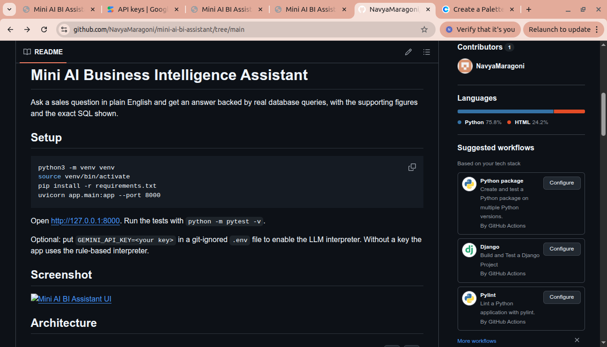
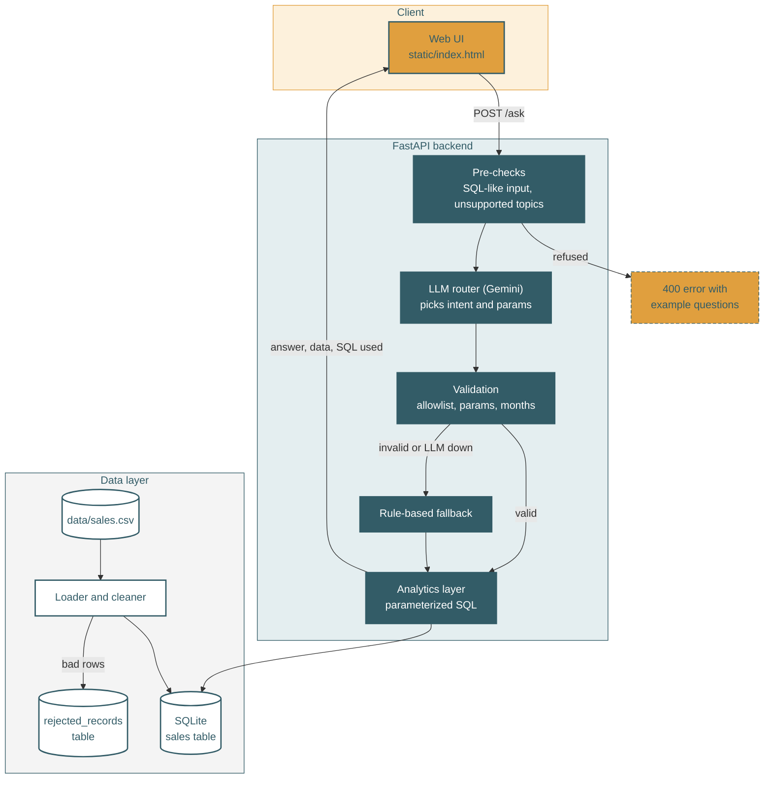

# Mini AI Business Intelligence Assistant

Ask a sales question in plain English and get an answer backed by real database queries, together with the supporting figures and the exact SQL that produced them.



## In one minute

- **What it does:** you type "Which product generated the highest revenue?" and the app replies with the answer, a chart, a supporting-data table, and a panel showing how the answer was produced.
- **Key design decision:** the AI never writes SQL and never sees the data. It only decides *which* pre-written, parameterized query to run. Every number comes from deterministic code, so answers can be checked.
- **Safe by default:** unsupported or risky questions are refused with example questions instead of being answered wrongly. Dirty data is quarantined, not silently dropped.
- **Works without an API key:** a rule-based interpreter takes over whenever the LLM is missing, slow, or returns something invalid.

## Table of contents

1. [Quick start](#quick-start)
2. [What you can ask](#what-you-can-ask)
3. [How it works](#how-it-works)
4. [Data handling and assumptions](#data-handling-and-assumptions)
5. [AI integration and safeguards](#ai-integration-and-safeguards)
6. [API reference](#api-reference)
7. [Testing](#testing)
8. [Project structure](#project-structure)
9. [AI usage](#ai-usage)
10. [Known limitations and future improvements](#known-limitations-and-future-improvements)
11. [Troubleshooting](#troubleshooting)

## Quick start

Requires Python 3.10 or newer.

```bash
git clone https://github.com/NavyaMaragoni/mini-ai-bi-assistant.git
cd mini-ai-bi-assistant
python3 -m venv venv
source venv/bin/activate        # Windows: venv\Scripts\activate
pip install -r requirements.txt
uvicorn app.main:app --port 8000
```

Open http://127.0.0.1:8000. The database is rebuilt from `data/sales.csv` every time the server starts, so there is nothing else to set up.

**Optional: enable the LLM interpreter.** Create a free key at https://aistudio.google.com/apikey and put it in a git-ignored `.env` file in the project root:

```
GEMINI_API_KEY=your-key-here
GEMINI_MODEL=gemini-3.5-flash-lite
```

Without a key the app still works fully, using the rule-based interpreter. The UI shows which interpreter answered each question.

Run the tests with `python -m pytest -v`.

## What you can ask

| Question | Intent | Example answer from the sample data |
|---|---|---|
| What is the total revenue? | `total_revenue` | Total revenue is 1,439,200.00 from 48 completed orders. |
| Which product generated the highest revenue? | `top_product` | Monitor generated the highest revenue: 473,000.00. |
| Which region generated the highest sales? | `top_region` | The South region generated the highest sales: 411,200.00. |
| What is the monthly revenue trend? | `monthly_trend` | Revenue went from 210,250.00 in January 2026 to 211,250.00 in June 2026, peaking in May 2026 (318,500.00). |
| How did revenue change between February and March? | `revenue_change` | Revenue decreased from 234,600.00 to 223,900.00: a change of -10,700.00 (-4.56%). |

Questions the assistant deliberately **refuses** (HTTP 400, with example questions in the response):

| Question | Why it is refused |
|---|---|
| Which region had the lowest sales? | "Lowest" is not supported. Answering with the highest region would be wrong. |
| What is the revenue of Monitor? | Filtering by one product or region is not supported yet. |
| What was revenue in March? | Single-month questions are not supported. Compare two months instead. |
| DROP TABLE sales; | Looks like a database command. The app is read-only. |

## How it works



The layers are separate on purpose, so each can be tested and replaced independently:

1. **Data layer** (`app/database.py`): reads the CSV, validates each row, loads valid rows into SQLite, and stores rejected rows with the reason.
2. **Analytics layer** (`app/analytics.py`): five parameterized query functions. `INTENTS` is the allowlist of everything the system can do.
3. **Interpreter** (`app/interpreter.py`): rule-based question-to-intent mapping and the deterministic pre-checks. It is also the fallback.
4. **AI layer** (`app/ai.py`): asks Gemini to choose an intent, then validates the answer before anything runs.
5. **API** (`app/main.py`): FastAPI endpoints, request validation, and consistent error responses.
6. **UI** (`static/index.html`): one HTML file, no frameworks.

### Why not let the LLM write SQL?

A hybrid design (LLM routes, fixed SQL answers) was chosen over free-form text-to-SQL:

| | LLM routes to fixed queries (this project) | LLM writes SQL |
|---|---|---|
| Destructive queries | Impossible: the LLM cannot produce SQL at all | Needs a validator to block them |
| Wrong numbers | Business rules (what counts as revenue) live in one reviewed place | The LLM may re-derive the rules differently each time |
| Flexibility | Limited to supported intents | Much wider |
| Explainability | Intent, parameters and SQL are always shown | SQL is shown, but harder to trust |

The trade-off is flexibility. Supporting more question types means adding a new reviewed query and intent. A SELECT-only text-to-SQL mode with a validator is listed under future improvements.

## Data handling and assumptions

Input: `data/sales.csv`, 51 rows, 10 columns, January to June 2026. Every cleaning rule below came from profiling the file first (`profile_data.py`).

| Finding | Rule applied |
|---|---|
| TXN0051 has no `Unit_price` | **Rejected** into `rejected_records` with the reason "missing Unit_price". The price is not guessed, because a plausible but wrong number is worse than a visible gap. |
| TXN0034 has `Quantity` 0 | **Rejected** with the reason "quantity must be > 0". |
| TXN0033 has status `Returned` | **Loaded but excluded from revenue**, so it stays auditable. |
| Dates are `DD-MM-YYYY` | Parsed explicitly with that format and stored as ISO `YYYY-MM-DD`. Without this, `03-01-2026` could be read as 1 March and corrupt the monthly trend. |
| `Discount_amount` | Treated as a **flat amount per transaction**, not a percentage. This is an assumption. |

**Revenue = Quantity x Unit_price - Discount_amount, counting `Completed` orders only.**

Result: 51 rows read, 49 loaded, 2 rejected. 48 orders are Completed and 1 is Returned. Total revenue is 1,439,200.00.

Further protections:

- The database schema enforces rules itself (`CHECK (quantity > 0)`, `PRIMARY KEY`), so bad data is refused even if the Python validation has a bug.
- Duplicate transaction IDs and blank text fields are also rejected.
- Rejected rows are never silently dropped: each is stored with its reason and the original row as JSON.
- Tables are rebuilt on each load, so running it twice never duplicates data.

## AI integration and safeguards

The LLM (Gemini, called over REST with `httpx`) is a **router**. For each question it returns JSON like `{"intent": "revenue_change", "params": {"month_a": "2026-02", "month_b": "2026-03"}}`. Its output is untrusted input and passes through these layers:

| # | Safeguard | What it prevents |
|---|---|---|
| 1 | **Pre-checks run before the LLM**: SQL-looking input, unsupported topics, product/region filters | The LLM cannot be tricked into mapping a risky or unsupported question to the wrong intent |
| 2 | **Intent allowlist**: the intent must be one of the five in `INTENTS` | Unknown or invented actions never run |
| 3 | **Exact parameter check**: params must match what that intent needs, in `YYYY-MM` format | Extra or malformed parameters |
| 4 | **Hallucination check**: any month returned must appear in the user's question | Invented months |
| 5 | **Bound SQL parameters**: values are passed as `:a`, `:b`, never string-formatted | SQL injection |
| 6 | **Rule-based fallback**: used if the LLM is missing, slow, errors, or fails validation. The response includes `fallback_reason` | An LLM outage cannot take the app down |

Prompt design: temperature 0 and JSON-only output are requested, the system prompt lists the allowed intents and the months that exist in the data, and it states that the user's question is data, not instructions.

Other protections outside the AI layer: the UI builds the page with `textContent` (never `innerHTML`), so server text cannot inject HTML; and unexpected server errors return a generic message while the details go to the log.

## API reference

| Method | Path | Purpose |
|---|---|---|
| GET | `/` | The web UI |
| GET | `/health` | Status and data-load summary |
| POST | `/ask` | Answer a question |

```bash
curl -s -X POST localhost:8000/ask \
  -H "Content-Type: application/json" \
  -d '{"question": "Which product generated the highest revenue?"}'
```

Successful response (HTTP 200), abbreviated:

```json
{
  "question": "Which product generated the highest revenue?",
  "interpreter": "llm",
  "fallback_reason": null,
  "intent": "top_product",
  "answer": "Monitor generated the highest revenue: 473,000.00.",
  "data": [{"product": "Monitor", "revenue": 473000.0, "units_sold": 50}],
  "sql": "SELECT product, ROUND(SUM((quantity * unit_price - discount_amount)), 2) AS revenue, ...",
  "params": {}
}
```

Errors always use the shape `{"error": "<code>", "message": "..."}`:

| Status | `error` | When |
|---|---|---|
| 400 | `unsupported_question` | The question is outside what the app can answer correctly. Includes `supported_examples`. |
| 400 | `cannot_answer` | The question is valid but the data cannot answer it, for example a month with no data. |
| 422 | `invalid_request` | Missing, blank, or over-500-character question. |
| 500 | `internal_error` | Unexpected failure. Details are logged, not shown. |

## Testing

```bash
python -m pytest -v
```

The tests cover:

- **Data cleaning:** day-first date parsing, zero quantity, missing price, loader counts, rejected rows, returned orders kept in the database.
- **Analytics:** total revenue (Returned excluded), top product and region, monthly trend, month change, unknown months, same-month comparison, and intents outside the allowlist.
- **AI layer:** hallucinated months rejected, intents outside the allowlist rejected, markdown-fenced JSON accepted, "unsupported" verdicts refused, LLM failure falling back to rules, and SQL blocked before any LLM call.
- **API:** valid questions, 400 and 422 errors, SQL-injection attempts, overlong input, the UI page, and `/health`.

Tests use an injected fake LLM and clear the API key, so they never call the network and always give the same result. The real Gemini call was verified manually.

## Project structure

```
app/
  database.py      loader, validation, SQLite schema
  analytics.py     parameterized queries and the intent allowlist
  interpreter.py   rule-based interpreter and pre-checks
  ai.py            Gemini routing, output validation, fallback
  main.py          FastAPI app and error handling
static/index.html  the web UI
tests/             pytest suite
data/sales.csv     input data
docs/              screenshot
profile_data.py    data-profiling script used to derive the cleaning rules
```

## AI usage

**In the product:** Gemini is used only to interpret the question as one of five allowed intents. It does not generate SQL, compute numbers, or see the data. Its output is validated before use (see [AI integration and safeguards](#ai-integration-and-safeguards)), and the app works without it.

**During development:** this project was built step by step with Claude as a coding assistant. The workflow was to profile the data first, derive the cleaning rules from what was found, then build the data, analytics, API, AI, UI and test layers in order. Each step was run and checked against expected output before the next, and the revenue figures were cross-checked against an independent pandas calculation. The design decisions in this README (hybrid routing, rejecting rather than imputing, refusing unsupported questions) were reviewed and accepted by me, and I can explain and change any part of the code.

## Known limitations and future improvements

Limitations:

- Only five question types are supported. Product, region, category, channel and single-month filters are not.
- "Lowest", "average", profit, forecast and similar questions are refused rather than answered.
- The pre-check uses keyword matching, so it can refuse a valid question that happens to contain a blocked word (for example "day" or "year").
- The rule-based interpreter is keyword-based and can miss unusual phrasings. The LLM handles those better.
- The data covers January to June 2026 only. Other months return a clear error.
- `Discount_amount` is assumed to be a flat per-transaction amount.
- The database is rebuilt from the CSV at startup. There is no authentication, caching or multi-user handling.
- Model names change often. If the configured Gemini model is unavailable, the app falls back to the rule-based interpreter.

Future improvements:

- Add intents for lowest/average and for product, region and single-month filters.
- Impute missing prices with human review, instead of only rejecting.
- Optional text-to-SQL mode with a validator (SELECT only, allowlisted tables, one statement).
- Use the LLM's structured tool-calling instead of JSON text.
- Add authentication, caching, and CI running the tests on every push.

## Troubleshooting

| Symptom | Likely cause and fix |
|---|---|
| UI says "Rule-based" and `fallback_reason` shows `GEMINI_API_KEY is not set` | No key configured. This is normal and the app still works. |
| `fallback_reason` shows `Gemini returned HTTP 401` | The key is invalid or mistyped. Create a new one in Google AI Studio. |
| `fallback_reason` shows `HTTP 404 (model ...)` | The model name is not available for your key. Set `GEMINI_MODEL` in `.env` to a model your key lists. |
| `fallback_reason` shows `ReadTimeout` | The model was too slow. Use a lite or flash model. |
| `address already in use` on startup | An old server is still running. Stop it with `pkill -f "uvicorn app.main:app"`. |
| `python: command not found` on Ubuntu | Activate the virtual environment, or use `python3`. |

## How data is stored and queried

- **Storage:** a SQLite file (`data/sales.db`) rebuilt from `data/sales.csv` at every startup, so it never holds duplicates.
- **Tables:** `sales` holds the 49 clean rows, with ISO dates, an `order_month` column for monthly grouping, and CHECK constraints (quantity > 0, unit_price > 0, discount >= 0). `rejected_records` holds the 2 rejected rows with the reason and the original row as JSON.
- **Querying:** five pre-written, parameterized SELECT queries in `app/analytics.py`. Values are bound parameters, never concatenated into SQL, and neither user text nor LLM output is ever executed as SQL. Each API response includes the exact SQL used.
