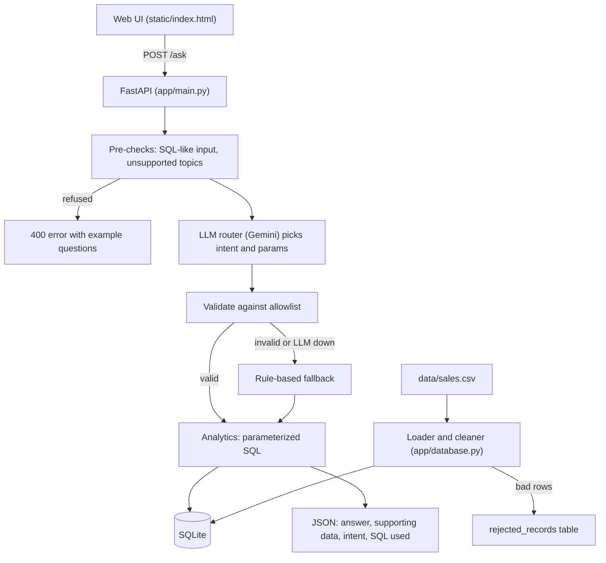

# Mini AI Business Intelligence Assistant

Ask a sales question in plain English and get an answer backed by real database
queries, with the supporting figures and the exact SQL shown.

## Setup

```bash
python3 -m venv venv
source venv/bin/activate
pip install -r requirements.txt
uvicorn app.main:app --port 8000
```

Open http://127.0.0.1:8000. Run the tests with `python -m pytest -v`.

Optional: put `GEMINI_API_KEY=<your key>` in a git-ignored `.env` file to enable
the LLM interpreter. Without a key the app uses the rule-based interpreter.

## Screenshot


## Architecture



## Example questions

| Question | Answer |
|---|---|
| What is the total revenue? | Total revenue is 1,439,200.00 from 48 completed orders. |
| Which product generated the highest revenue? | Monitor generated the highest revenue: 473,000.00. |
| Which region generated the highest sales? | The South region generated the highest sales: 411,200.00. |
| What is the monthly revenue trend? | Revenue went from 210,250.00 in January 2026 to 211,250.00 in June 2026, peaking in May 2026 (318,500.00). |
| How did revenue change between February and March? | Revenue decreased from 234,600.00 to 223,900.00: a change of -10,700.00 (-4.56%). |
| Which region had the lowest sales? | Refused (HTTP 400): questions involving "lowest" are not supported yet. |
| DROP TABLE sales; | Refused (HTTP 400): looks like a database command. The app is read-only. |

## Data decisions

| Issue | Rule |
|---|---|
| TXN0051 missing Unit_price | Rejected into `rejected_records` with the reason. A price is not guessed. |
| TXN0034 quantity 0 | Rejected into `rejected_records`. |
| TXN0033 status Returned | Loaded but excluded from revenue. |
| Dates are DD-MM-YYYY | Parsed explicitly and stored as ISO YYYY-MM-DD. |
| Discount_amount | Treated as a flat amount per transaction, not a percentage. |

**Revenue = Quantity x Unit_price - Discount_amount, for Completed orders only.**

Result: 51 rows read, 49 loaded, 2 rejected. Total revenue is 1,439,200.00 from 48
completed orders.

## Supported questions

Total revenue, top product, top region, monthly trend, and revenue change
between two named months.

## AI usage

- The LLM (Gemini) is only a router: it maps the question to one allowed intent
  and its parameters. It never writes SQL and never sees the data.
- All numbers come from pre-written, parameterized SQL, so they are deterministic.
- Safeguards: deterministic pre-checks before the LLM, an intent allowlist, exact
  parameter validation, a check that returned months appear in the question, and a
  rule-based fallback if the LLM is unavailable or invalid.
- Unsupported questions (lowest, specific product/region, single month, profit,
  forecasts) are refused with example questions instead of answered wrongly.
- AI-assisted development: this project was built with help from Claude, and I
  reviewed, ran and tested the code at each step.

## Known limitations

- Filtering by a specific product, region or single month is not supported.
- "Lowest" and "average" style questions are refused, not answered.
- The rule-based interpreter is keyword-based and can refuse valid rephrasings.
- Dates cover Jan to Jun 2026 only; other months return a clear error.
- The real Gemini call is untested in automated tests (a fake LLM is used).
- Rows with a missing price are rejected, not imputed.
- Possible improvements: imputation with review, optional text-to-SQL with a
  SELECT-only validator, authentication, and caching.
