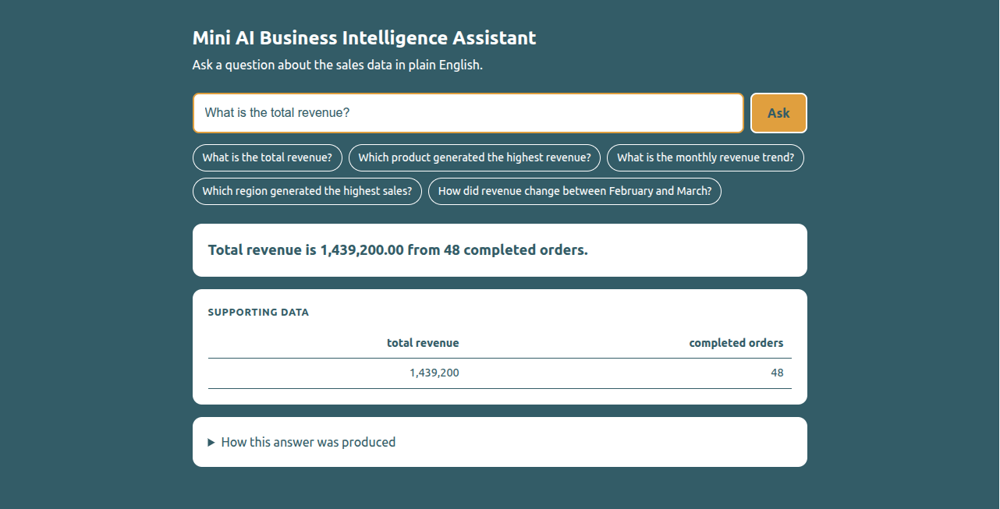
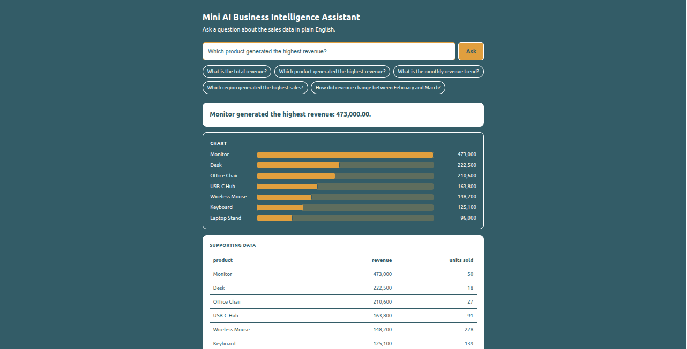
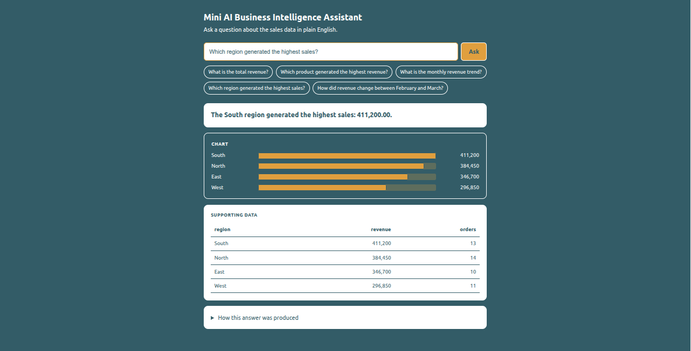
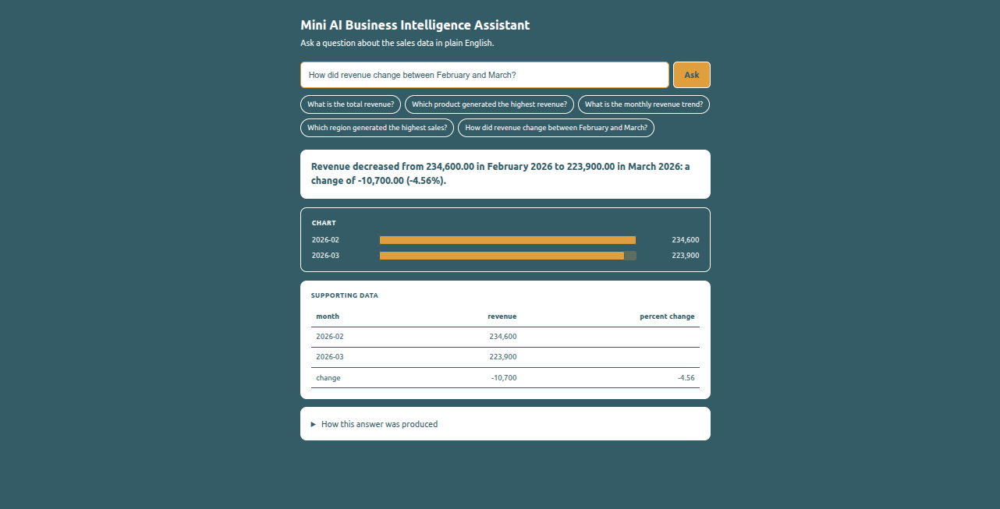

# Mini AI Business Intelligence Assistant

Ask a sales question in plain English and get an answer backed by a real database
query, together with the supporting figures and the exact SQL that produced them.

Built for the *AI-Assisted Development Challenge (GET selection)*.

| | |
|---|---|
| **Stack** | Python 3.10, FastAPI, SQLite, pandas, pytest, Gemini API (optional) |
| **Supported questions** | total revenue, top product, top region, monthly trend, revenue change between two months |
| **Tests** | 17 automated tests (`python -m pytest -v`) |
| **AI development report** | [docs/AI_USAGE.md](docs/AI_USAGE.md) |

## Screenshots

| Total revenue | Top product |
|---|---|
|  |  |

| Top region | Revenue change (Feb to Mar) |
|---|---|
|  |  |

## Setup and run

Requires Python 3.10 or newer.

```bash
git clone https://github.com/NavyaMaragoni/mini-ai-bi-assistant.git
cd mini-ai-bi-assistant
python3 -m venv venv
source venv/bin/activate          # Windows: venv\Scripts\activate
pip install -r requirements.txt
uvicorn app.main:app --port 8000
```

Open **http://127.0.0.1:8000** and ask a question, or click one of the example chips.
The database is rebuilt from `data/sales.csv` every time the server starts.

Run the tests:

```bash
python -m pytest -v
```

### Optional: enable the LLM interpreter

The app works with no API key (it uses a rule-based interpreter). To let Gemini interpret
questions, create a free key at https://aistudio.google.com and store it in a git-ignored
`.env` file in the project root:

```
GEMINI_API_KEY=your_key_here
GEMINI_MODEL=gemini-2.5-flash      # optional, this is the default
```

The UI's "How this answer was produced" panel shows which interpreter answered
(`LLM (Gemini)` or `Rule-based`) and, if the LLM was skipped, why.

## Example questions and verified answers

| Question | Answer |
|---|---|
| What is the total revenue? | 1,439,200.00 from 48 completed orders |
| Which product generated the highest revenue? | Monitor, 473,000.00 |
| What is the monthly revenue trend? | Jan 210,250 to Jun 211,250, peak in May (318,500) |
| Which region generated the highest sales? | South, 411,200.00 (North 384,450, East 346,700, West 296,850) |
| How did revenue change between February and March? | 234,600 to 223,900: -10,700.00 (-4.56%) |

Questions the assistant refuses (rather than answering wrongly): lowest/worst, a specific
product or region, a single month, profit, forecasts, and anything that looks like SQL.

## Architecture

```
Browser UI (static/index.html)
   |  POST /ask
   v
FastAPI (app/main.py)  -- validates the request, returns structured JSON or a clear error
   |
   v
Pre-checks (app/interpreter.py)  -- no LLM involved
   refuse: SQL-like input, unsupported topics (lowest, profit...), specific product/region
   |
   v
AI interpreter (app/ai.py)  -- Gemini picks ONE intent + parameters, as JSON
   |  validate: intent in allowlist, exact parameters, months really in the question
   |-- fails or LLM unavailable --> rule-based interpreter (app/interpreter.py)
   v
Analytics layer (app/analytics.py)  -- pre-written, parameterized SELECT queries
   v
SQLite: sales + rejected_records   <--  loader/cleaner (app/database.py)  <--  data/sales.csv
   |
   v
JSON response: answer, supporting data, intent, parameters, SQL used
```

**Key design decision: the LLM only routes, it never writes SQL.** It maps the question to
one of five allowed intents and extracts parameters. The numbers always come from
deterministic, pre-written queries. This makes answers reproducible and makes destructive
operations impossible by construction: there is no path from user text or LLM output to
executed SQL.

## Data management

### Data decisions

The CSV has 51 rows. Profiling (`profile_data.py`) found three problem rows and one format trap:

| Issue | Rule applied |
|---|---|
| TXN0051: missing `Unit_price` | Rejected into `rejected_records` with the reason. A price is not guessed. |
| TXN0034: quantity is 0 | Rejected into `rejected_records` (`quantity must be > 0`). |
| TXN0033: status `Returned` | Loaded, but excluded from revenue. |
| Dates are `DD-MM-YYYY` | Parsed explicitly and stored as ISO `YYYY-MM-DD`. |
| `Discount_amount` | Treated as a flat amount per transaction, not a percentage. |

**Revenue = Quantity x Unit_price - Discount_amount, for `Completed` orders only.**

Result: 51 rows read, **49 loaded, 2 rejected**. Total revenue is 1,439,200.00 from 48 completed orders.

### How data is stored and queried

- **Storage:** a SQLite file (`data/sales.db`), rebuilt from the CSV at every startup so it never holds duplicates.
- **Tables:** `sales` holds the clean rows with ISO dates, an `order_month` column for monthly grouping, and `CHECK` constraints (quantity > 0, unit_price > 0, discount >= 0). `rejected_records` holds each rejected row with the reason and the original row as JSON, so nothing is silently dropped.
- **Querying:** five pre-written, parameterized `SELECT` queries in `app/analytics.py`. Values are bound parameters, never concatenated into SQL. Every API response includes the exact SQL used.

## AI integration and safeguards

How unsupported or incorrect answers are prevented:

1. **Deterministic pre-checks run before the LLM.** SQL-looking input, "lowest/worst" questions, unsupported dimensions and specific product/region filters are refused up front, so the LLM can never map them to the wrong intent.
2. **Intent allowlist.** The LLM can only choose from the five intents in `INTENTS`; anything else is rejected.
3. **Strict parameter validation.** Parameters must match exactly what the intent needs, in `YYYY-MM` format.
4. **Hallucination check.** Any month the LLM returns must actually appear in the user's question.
5. **Fallback.** If the LLM is unavailable or its output fails validation, the rule-based interpreter answers instead, and the response reports `fallback_reason`.
6. **Honest refusals.** Unsupported questions return a clear message plus example questions.

Destructive operations are not possible: the app is read-only, uses bound parameters, and never executes user or LLM text as SQL.

## API

`POST /ask` with `{"question": "Which product generated the highest revenue?"}`:

```json
{
  "question": "Which product generated the highest revenue?",
  "interpreter": "llm",
  "fallback_reason": null,
  "intent": "top_product",
  "answer": "Monitor generated the highest revenue: 473,000.00.",
  "data": [{"product": "Monitor", "revenue": 473000.0, "units_sold": 50}, "..."],
  "sql": "SELECT product, ROUND(SUM((quantity * unit_price - discount_amount)), 2) AS revenue, ...",
  "params": {}
}
```

| Status | `error` code | When |
|---|---|---|
| 400 | `unsupported_question` | The question is outside what can be answered correctly (includes example questions) |
| 400 | `cannot_answer` | The question is valid but the data can't answer it (e.g. a month with no data) |
| 422 | `invalid_request` | Missing, empty, blank or over-500-character question, or a non-JSON body |
| 500 | `internal_error` | Unexpected failure; details are logged, not shown to the user |

`GET /health` reports the data load summary. `GET /` serves the UI.

## Testing

17 automated tests in `tests/test_app.py`:

- **Data cleaning (4):** day-first date parsing, zero quantity rejected, missing price rejected, loader counts (51 / 49 / 2).
- **Analytics (5):** returned orders excluded from revenue, top product, Feb to Mar change, unknown month, intent outside the allowlist.
- **AI layer (4):** hallucinated month rejected, intent outside the allowlist rejected, LLM outage falls back to rules, SQL input blocked before the LLM is called.
- **API (4):** valid question, unsupported question (400), blank question (422), SQL injection attempt refused.

Tests never call the real LLM (a fake LLM is injected and the API key is cleared).

## Known limitations

- Filtering by a specific product, region or single month is not supported.
- "Lowest", "average" and "profit" style questions are refused, not answered.
- The rule-based interpreter is keyword-based and can refuse valid rephrasings; the LLM path handles these better.
- The data covers January to June 2026; other months return a clear error.
- The live Gemini call is verified manually, not in automated tests.
- Rows with a missing price are rejected, not imputed.
- Test fixtures rebuild the real `data/sales.db` rather than using an isolated test database.

## Project structure

```
app/
  main.py          FastAPI app, /ask endpoint, error handling
  ai.py            Gemini routing + output validation + fallback
  interpreter.py   pre-checks and rule-based interpreter
  analytics.py     parameterized queries and the intent allowlist
  database.py      CSV loader, validation, SQLite schema
static/index.html  single-page UI (answer, chart, table, SQL panel)
data/sales.csv     source data
tests/test_app.py  pytest suite
docs/AI_USAGE.md   AI tools used, problems and debugging
docs/screenshots/  UI screenshots
profile_data.py    data profiling script used before writing the loader
```

## With another day of work

- Optional text-to-SQL mode with a SELECT-only validator.
- Filters (region, product, month) and "lowest/average" questions.
- Isolated test database, plus tests for the LLM and error paths.
- Authentication, caching, and logging of refused questions.

## AI-assisted development

Which tools were used, how, the problems encountered and how they were debugged:
see [docs/AI_USAGE.md](docs/AI_USAGE.md).
